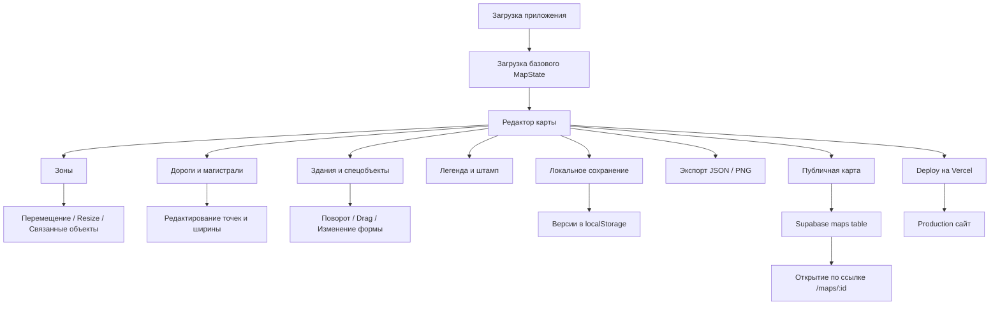

<div align="center">

# 🏙️ Urban Blueprint City Techplan
### Интерактивный редактор технического генплана и градостроительных схем

🧭 Веб-проект для создания, редактирования и публикации 2D-схем города в стиле инженерного генплана: зоны, дороги, здания, ворота, служебные элементы и публичные карты.

---

[](https://city-techplan-react.vercel.app)
[](https://github.com/DIBERLOG/urban-blueprint_city-techplan)
[](https://github.com/DIBERLOG/urban-blueprint_city-techplan/blob/main/LICENSE.md)
[](https://city-techplan-react.vercel.app)

---

🛡️ **Лицензия проекта**  
Проект распространяется по лицензии **Urban Blueprint License v1.0 (UBL-1.0)**.  
Использование, копирование, публикация и модификация материалов разрешены **только с письменного разрешения автора**.

</div>

---

## 🚀 Описание проекта

**Urban Blueprint City Techplan** — это интерактивный редактор технического генплана города, выполненный в формате строгой 2D-схемы сверху.  
Проект ориентирован на создание визуально читаемых и редактируемых градостроительных планов в инженерной подаче: тёмный CAD-подобный интерфейс, SVG-карта, редактор зон и объектов, локальные и публичные сохранения.

Редактор позволяет работать с:
- городскими зонами;
- дорогами и магистралями;
- зданиями разных форм;
- воротами, легендой, штампом и служебными элементами;
- экспортом карты и публикацией через веб.

---

## ✨ Основные возможности

✅ **Интерактивная SVG-карта города**  
Генплан редактируется прямо в браузере: объекты можно выделять, двигать, удалять, копировать и поворачивать.

✅ **Редактор зон**  
Можно создавать новые зоны, двигать их отдельно или вместе со связанными зданиями, менять размеры по сторонам и углам.

✅ **Редактор дорог и магистралей**  
Поддерживаются обычные дороги и магистрали с редактируемыми точками и шириной.

✅ **Библиотека форм зданий**  
Поддерживаются прямоугольные, L-образные, U-образные, восьмиугольные, трапециевидные, квартальные, производственные и специальные формы.

✅ **Парки, деревья и служебные элементы**  
Можно добавлять парки, группы деревьев, ворота, а также управлять легендой и штампом чертежа.

✅ **Локальные сохранения и версии**  
Редактор хранит карту в `localStorage`, поддерживает версии сохранений, сброс к базовому состоянию и undo/redo.

✅ **Экспорт и обмен картой**  
Карта экспортируется в `JSON` и `PNG`, копируется как локальная share-ссылка и может публиковаться как публичная карта.

✅ **Публичные карты через Supabase**  
Одна и та же карта может открываться по ссылке `/maps/:id`, а изменения сохраняются в базе.

✅ **Production-деплой**  
Проект уже развернут на Vercel и готов к использованию как веб-продукт.

---

## 🧱 Технологический стек

<p align="center">

| Раздел | Технологии |
|------|------------|
| 🖥️ Frontend | React 18, TypeScript, Vite |
| 🗺️ Карта | SVG, кастомный редактор объектов |
| 🧠 Архитектура | Компонентная структура + единый `MapState` |
| 🎨 UI/UX | CAD-подобный интерфейс, моноширинная подача, адаптивная панель |
| 💾 Локальные данные | `localStorage`, JSON, история версий |
| 🌐 Публичные карты | Supabase |
| 🚀 Деплой | Vercel |
| 🔒 Конфигурация | `.env`, Vercel env vars, RLS policies |
| 🤖 CI | GitHub Actions |

</p>

---

## 🧩 Структура проекта

```text
city-techplan-react/
│
├── public/
│   └── favicon.svg              # иконка проекта
│
├── src/
│   ├── App.tsx                  # основной редактор генплана
│   ├── cityData.ts              # базовое состояние карты и типы
│   ├── sharedMap.ts             # публичные карты через Supabase
│   ├── styles.css               # интерфейс редактора
│   ├── main.tsx                 # вход React-приложения
│   └── vite-env.d.ts            # типы env для Vite
│
├── supabase/
│   └── maps.sql                 # таблица и политики доступа для публичных карт
│
├── .github/
│   └── workflows/
│       └── ci.yml               # автоматическая проверка сборки в GitHub Actions
│
├── .env.example                 # пример env-переменных
├── index.html                   # html-шаблон
├── package.json                 # скрипты и зависимости
├── vercel.json                  # конфигурация деплоя и rewrite для /maps/*
├── LICENSE.md                   # лицензия проекта
└── README.md
```

---

## 🔄 Логика редактора и публикации карт



---

## ⚙️ Локальный запуск

Установка зависимостей:

```bash
npm install
```

Запуск dev-сервера:

```bash
npm run dev
```

Сборка production:

```bash
npm run build
```

Preview production-сборки:

```bash
npm run preview
```

---

## 🧪 Настройка Supabase

Создай `.env` по шаблону `.env.example`:

```env
VITE_SUPABASE_URL=https://your-project.supabase.co
VITE_SUPABASE_ANON_KEY=your-public-anon-key
```

Дальше:

1. Создай проект в Supabase.
2. Выполни SQL из `supabase/maps.sql`.
3. Добавь те же env-переменные в Vercel.
4. Перезадеплой production.

---

## 🚀 Деплой

Preview:

```bash
npm run deploy:preview
```

Production:

```bash
npm run deploy:prod
```

Текущий production:

- `https://city-techplan-react.vercel.app`

---

## 🛠️ GitHub Actions

В репозитории настроен CI-процесс:

- на `push` в `main`
- на `pull_request`

Он выполняет:

1. `npm ci`
2. `npm run build`

---

## 🧭 Базовое состояние карты

Кнопка `Сбросить` возвращает карту к базовому JSON-состоянию, зашитому в `src/cityData.ts`.  
Это состояние используется как исходная версия проекта и как опорная схема после полного сброса.

---

<div align="center">

🛡️ **Лицензия проекта**  
Urban Blueprint City Techplan является авторским проектом.  
Любое использование материалов допускается только с согласия автора.  
[](https://github.com/DIBERLOG/urban-blueprint_city-techplan/blob/main/LICENSE.md)

✨ Город как система начинается с карты, а карта начинается со структуры. ✨

</div>
